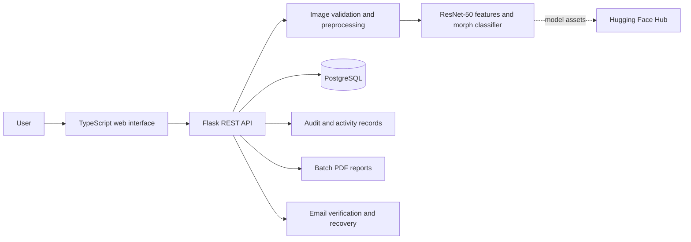

# AI Morph Detection

AI Morph Detection is a web application for reviewing facial images and assessing whether they may be genuine or digitally morphed. It combines a guided analysis experience with image validation, facial alignment, machine learning inference, user accounts, and administrative tools. The application is intended to support review and research; its results are estimates and should not be treated as definitive proof of identity or image authenticity.

## What the application does

- **Analyze facial images:** Submit one image or a batch of up to 50 images through the analysis workspace.
- **Validate submissions:** Check supported image formats, file integrity, and a 10 MiB per-image size limit before analysis.
- **Prepare faces for analysis:** Detect a face, reject images with multiple faces, align facial landmarks, crop and normalize the face, and flag images that do not meet the quality checks.
- **Estimate morph likelihood:** Extract a 2,048-dimensional visual representation with ResNet-50 and evaluate it using the trained binary morph classifier.
- **Present explainable results:** Show a Genuine or Morphed prediction with confidence values for both classes, along with an analysis status and submission record.
- **Process batches:** Analyze images independently, summarize successful and failed items, and generate a downloadable PDF report.
- **Support user accounts:** Provide email and password registration, email verification, password recovery and changes, and optional Google sign-in.
- **Provide account and admin views:** Let users review their activity and profile statistics. Authorized administrators can review registered users and recent activity, and remove eligible user accounts.
- **Maintain operational records:** Store account and analysis history in PostgreSQL and keep audit events for protected operations.

## Analysis workflow

1. The application validates the uploaded file and records its submission metadata.
2. OpenCV detects a face and uses facial landmarks to align and prepare it for the model. Unsupported, invalid, blurry, or multi-face images are reported for correction.
3. Torchvision's pretrained ResNet-50 extracts image features from the normalized face.
4. The project-trained PyTorch classifier returns probabilities for the **Genuine** and **Morphed** classes.
5. The backend formats the result, records the user's analysis history, and includes it in the batch report when applicable.

## Technology stack

| Area | Technologies |
| --- | --- |
| Web interface | TypeScript, Vite, HTML, CSS |
| Application API | Python, Flask, Flask-CORS |
| Image handling | Pillow, OpenCV with the contrib modules |
| Feature extraction and classification | PyTorch, Torchvision, ResNet-50, project-trained classifier |
| Persistence | PostgreSQL, SQLAlchemy, Psycopg |
| Authentication | Flask sessions, Werkzeug password hashing, Authlib for Google OAuth |
| Transactional email | Google Apps Script Gmail relay, with configurable Resend or SMTP alternatives |
| Batch reporting | ReportLab PDF generation |
| Model asset storage | Hugging Face Hub model repository |

## Application architecture

The frontend handles navigation, image submission, progress, and result presentation. The Flask API manages authenticated requests, validation, inference orchestration, account and activity records, and report delivery. Model weights are maintained separately from application source so they can be versioned as model assets.

## Result interpretation

The classifier reports model confidence for the two output classes. Confidence is not a guarantee of correctness. Image quality, capture conditions, demographic representation, and differences between the evaluated image and the model's training data can affect results. Use the output as a screening aid and rely on appropriate human review for consequential decisions.

## Project scope

AI Morph Detection is a software engineering and machine learning project focused on an end-to-end image analysis workflow. It brings together a responsive user-facing website, account management, image processing, model inference, batch reporting, persistent history, and protected administration in one application.
